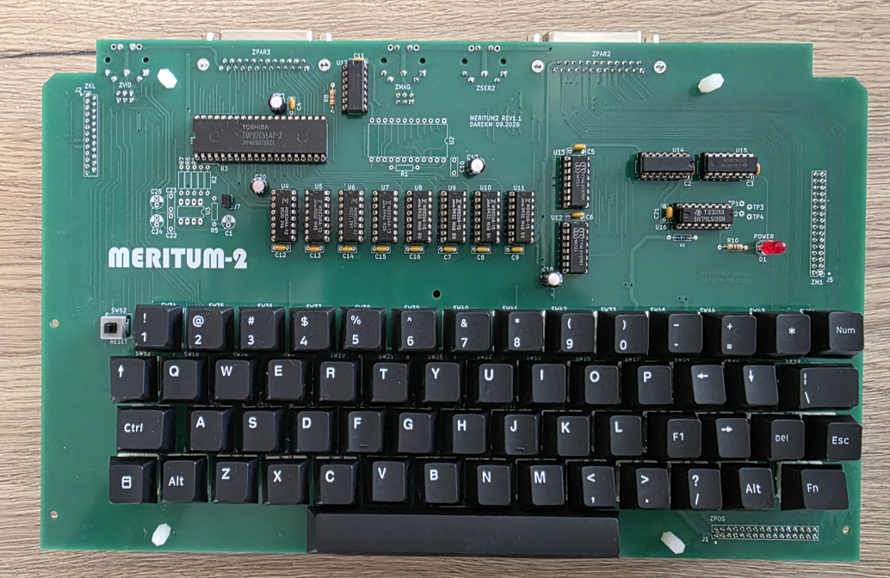
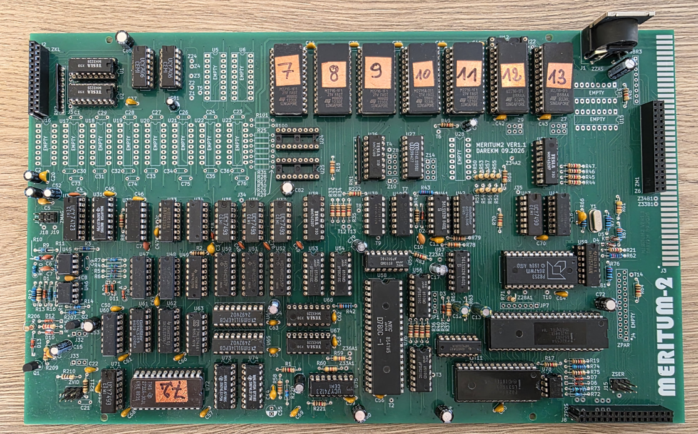
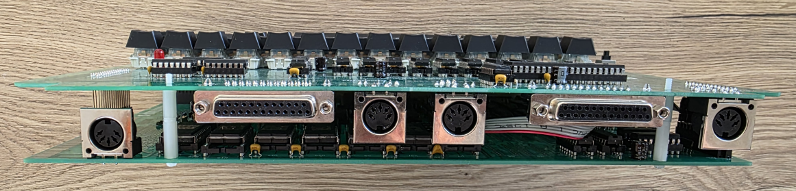
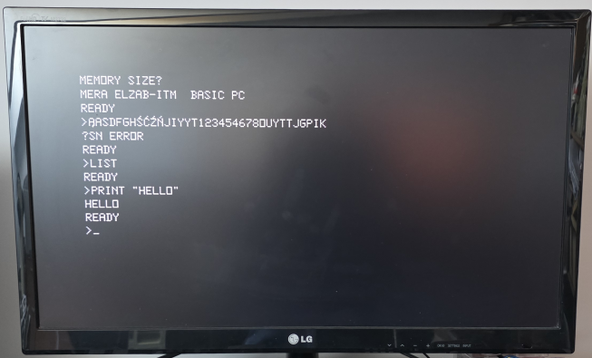

# Meritum-2: Polish 8-bit Home Computer
This repository provides all the files needed to build a **Meritum 1 (Model 2) = Meritum2** ( https://pl.wikipedia.org/wiki/Meritum_(komputer) ) hardware recreation, closely following the design of the first microcomputer to be mass‑produced in Poland. 

**Meritum 1 (Model 2)**  
Basic Technical Specifications:
* RAM: 48 KB (RAMD)
* ROM: 14 KB (BASIC)
* Video Memory: 1 KB (RAMS)
* Display Modes: Text — 16×64 or 16×32
* Peripherals: serial interface (i8251), parallel interface (i8255), tape interface, fdd interface (i8255)
* Colors: Monochrome
 
As of November 11, 2026, there is one successful build based on this PCB revision and three successful builds based on a previous PCB revision. 

As additional fixes were identified during testing, the repository includes an updated PCB revision (Rev. 1.2), whereas the PCB shown in the photo is Rev. 1.1.  
 

Top view of the mainboard: 

Side view of the computer with connectors: 

Example startup screen: 

Important notes: 
* Please note that this is a complex hardware project that requires solid technical expertise from anyone who decides to build it. 
* While significant care has been taken during the design and verification process, the project may still need additional fixes, especially if the original design included fixes implemented directly at the PCB level that were not reflected in the published schematics.

## PCBs
The clone consists of two separate PCBs:
* [Meritum2_PGW](Meritum2_PGW) (Meritum Płyta Główna) - is the main board.
* [Meritum2_KLT](Meritum2_KLT) (Meritum Klawiatura) - is a replacement keyboard that uses standard Cherry MX switches.

## ROMs
Since the licensing status of the ROMs used in the Meritum 2 computer is not clear to me, I have not included them in this repository.  
Below, however, I provide links to a websites where they can be found, along with many other valuable resources:
* https://web.archive.org/web/20201023154655/https://sites.google.com/site/krzkomar/meritum-1
* https://www.planetemu.net/rom/mame-roms-merged/meritum1 
  
Many useful materials can also be found at: https://www.speccy.pl/news.php .

## Assembling
Although the mainboard includes several configuration jumpers, it does not require any additional settings that need to be adjusted before powering it on. The default configuration is sufficient. 

To connect mainboard with keyboard I have used:
-  single and double Row, 2.54mm straight, Gold PCB Female Sockets Connector
-  single and double Row, 2.54mm straight, Gold PCB Male Pin Header connector (h=29.5mm)
  
More to follow.
